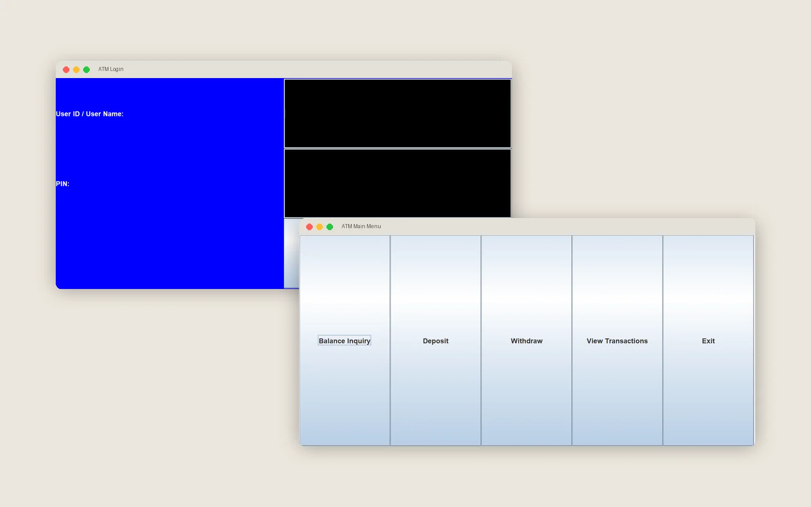

# ATM Banking System (Java Swing)

A desktop ATM simulator with a Swing GUI: log in, check your balance, deposit, withdraw and review your transaction history. Account data and transactions are saved to text files.

Object-Oriented Programming (CS2132) final project, Effat University, Spring 2025.

> 📄 Case study: [osvr7.github.io/project.html?p=java-atm](https://osvr7.github.io/project.html?p=java-atm)



## Features

- Login screen with user ID and PIN validation
- Balance inquiry, deposit and withdrawal, with input validation and error dialogs
- Transaction history for the signed-in account
- Persistence: accounts and transactions are written to and read back from text files
- Admin helper class for creating accounts, resetting PINs and generating reports

## Object-oriented design

| Class | Responsibility |
|---|---|
| `Account` (abstract) | Account number, holder, balance, deposit and withdraw |
| `CheckAccount` | Checking account with an overdraft limit |
| `SavingsAccount` | Savings account with interest calculation |
| `User` | Credentials and the user's accounts |
| `Transaction` | ID, account, amount, type and timestamp |
| `ATM` | Authentication, operations and file persistence |
| `Admin` | User and account administration |
| `ATMSystemTest` | Entry point and Swing GUI |

## Run it

Requires a JDK (Java 8 or newer).

```bash
javac -d out src/*.java
java -cp out ATMSystemTest
```

Demo logins are created in `ATMSystemTest.main`: user `1234` with PIN `1111`, and user `Joman` with PIN `2222`.

> On first run the app looks for `user_credentials.txt` and prints a "file not found" message if it doesn't exist yet. The demo users above still work. Files such as `1001_accounts.txt` and `1001_transactions.txt` are created as you use the app.

## Team

**Osama Abutaha** · Joman Alsharbini
